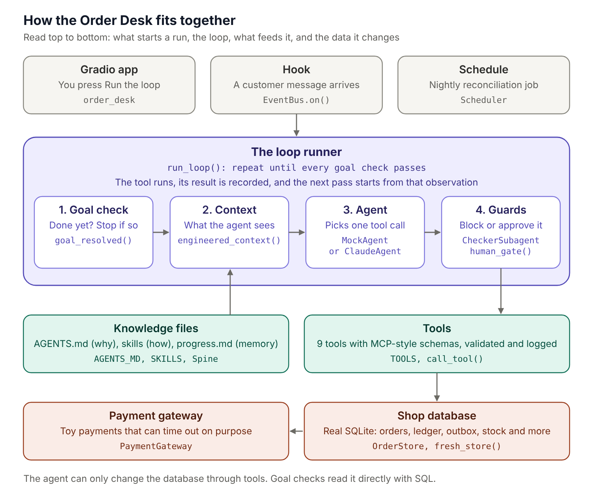

# Loop Engineering: the Order Desk

A hands-on companion to the article **Loop Engineering for AI Agents: Stop Writing Prompts, Start Designing Loops**.

The notebook runs a small online shop on a real SQLite database. An AI agent handles customers who want to place, cancel, return and refund orders, and every idea from the article becomes a scenario you can run and watch: goals, triggers, context and skills, the spine (`progress.md`), tools, a checker subagent, intent (`AGENTS.md`) and a human in the loop.



## What is inside

| # | Scenario | What you will see |
|---|---|---|
| 1 | Prompt engineering vs loop engineering | Six hand-written prompts replaced by one goal |
| 2 | The core loop | Goal, Act, Observe, Adjust, including a failed action the agent recovers from |
| 3 | Weak goals vs verifiable goals | A loop that stops too early, one that never stops, one that knows when it is done |
| 4 | Triggers | A hook fired by a customer message and a nightly scheduled job |
| 5 | Context and skills | Bloated context vs engineered context, and skills loaded on demand |
| 6 | The spine | A payment timeout that causes a double refund, and the memory that prevents it |
| 7 | Tools | MCP-style tool schemas, validation and a tool usage log |
| 8 | Checker subagent | A wrong refund caught before the money leaves |
| 9 | Intent debt | A loop that reports success while refunding outside policy |
| 10 | Human in the loop | An approval gate with a review card |
| 11 | Everything together | Seven customers, one engineered loop, a reconciliation dashboard |
| App | The Order Desk | A Gradio app: pick a customer and an agent, switch loop parts on and off, run it live |

## Run it

```bash
pip install -r requirements.txt
jupyter lab loop_engineering_order_desk.ipynb
```

Or open it in Google Colab or VS Code and run the cells from top to bottom. The notebook installs what it needs in its first cell.

**No API key needed.** By default the agent is a **mock agent**: plain Python rules standing in for a model, so every lesson reproduces exactly. The database, tools, goal checks, spine, checker and human gate are all real code either way.

**Using a real Claude model (optional).**

1. Create a key at [console.anthropic.com](https://console.anthropic.com).
2. Make it available as the `ANTHROPIC_API_KEY` environment variable, or as a Colab secret with that name. Never paste a key into a notebook you share.
3. Set `USE_CLAUDE = True` in the setup cell, or simply pick a Claude model in the Order Desk app.

Expect a real model to vary from run to run and not to repeat the mock agent's mistakes on cue. That variability is the best argument for the engineering around the loop.

**The Order Desk app** needs a live kernel (Jupyter, JupyterLab, VS Code or Colab). It does not render on GitHub's static notebook preview.

## Files

* `loop_engineering_order_desk.ipynb`: the notebook, saved with its outputs so you can read it before running it
* `images/architecture.png` and `images/architecture.svg`: the architecture diagram
* `requirements.txt`: Python packages

Running the notebook creates a `loop_workspace/` folder holding `AGENTS.md`, the skills, every `progress.md` and the SQLite databases (`shop.db`, `order_desk.db`), which you can open with any SQLite browser.

## References

* Martin Keen, [What Is Loop Engineering? Building Better AI Agents](https://www.youtube.com/watch?v=DQBqh6gcx7U), IBM Technology
* [AGENTS.md](https://agents.md/), an open format for guiding coding agents
* Anthropic Engineering, [Equipping agents for the real world with Agent Skills](https://www.anthropic.com/engineering/equipping-agents-for-the-real-world-with-agent-skills)
* [Model Context Protocol](https://modelcontextprotocol.io/introduction)
* [Gradio documentation](https://www.gradio.app/docs)
